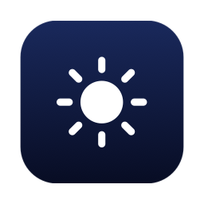
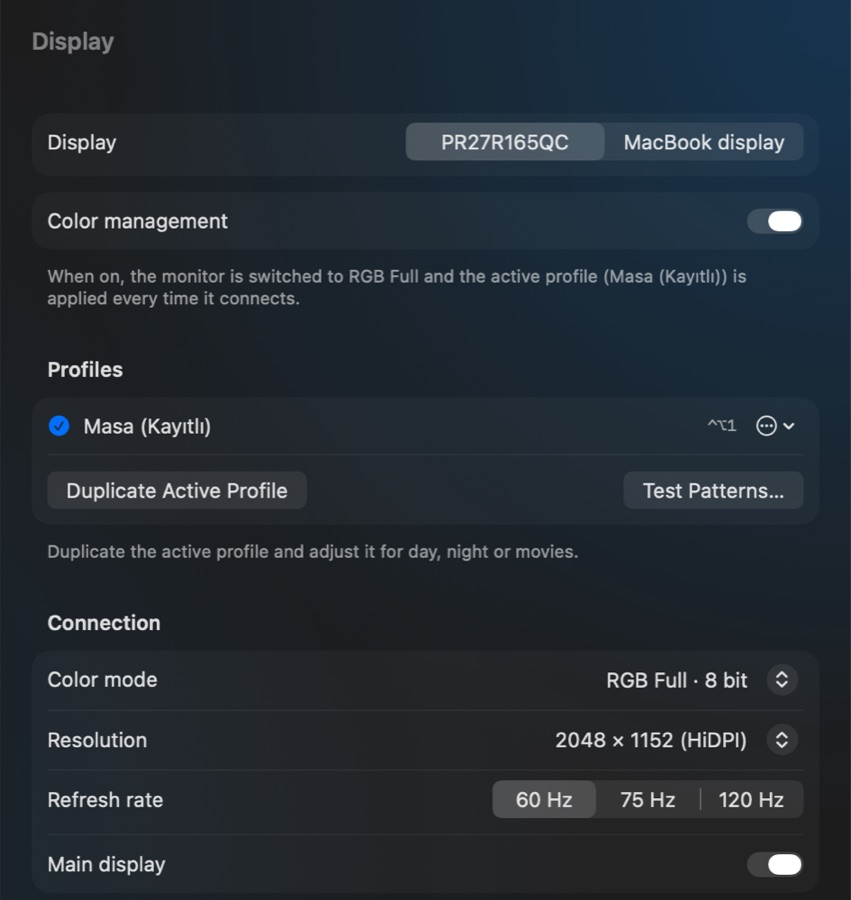
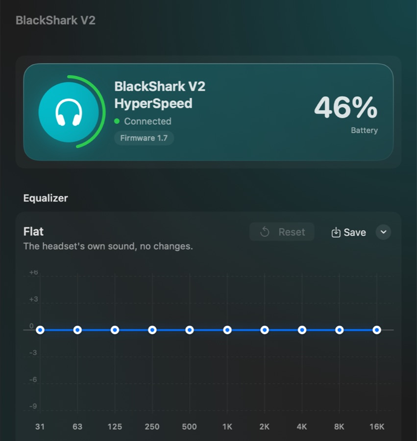
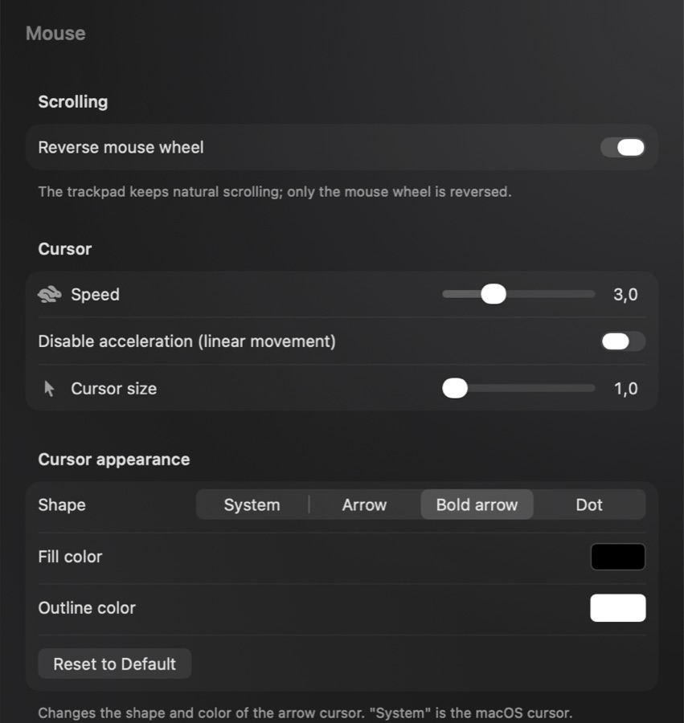
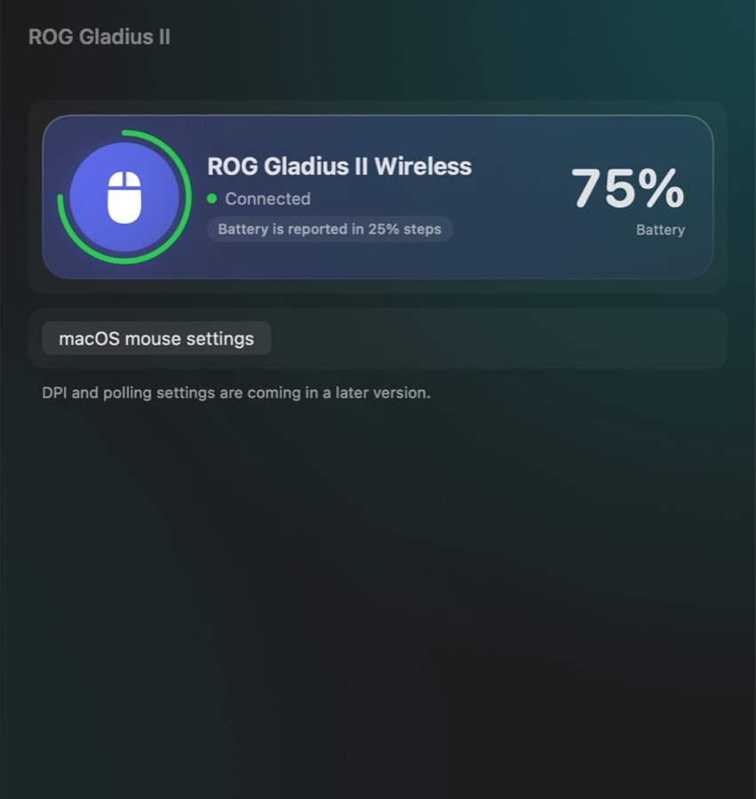
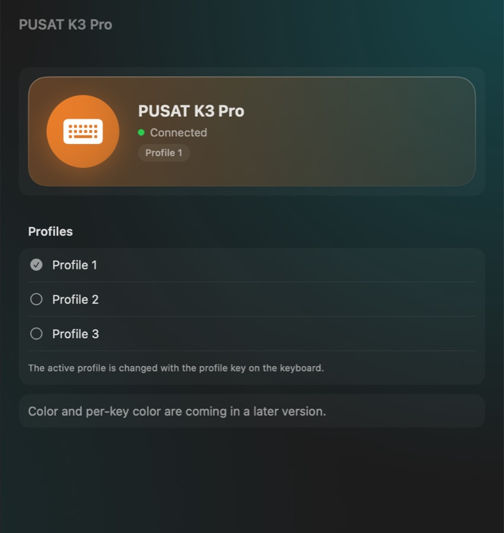
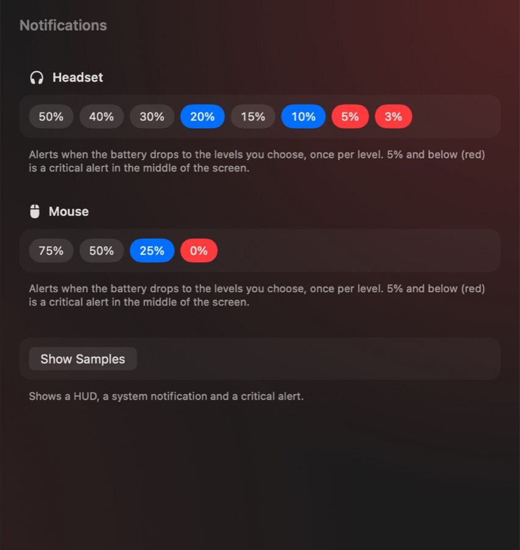
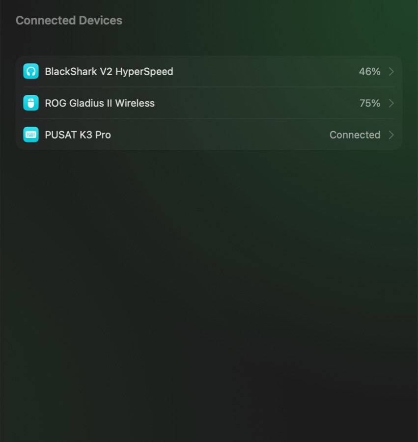
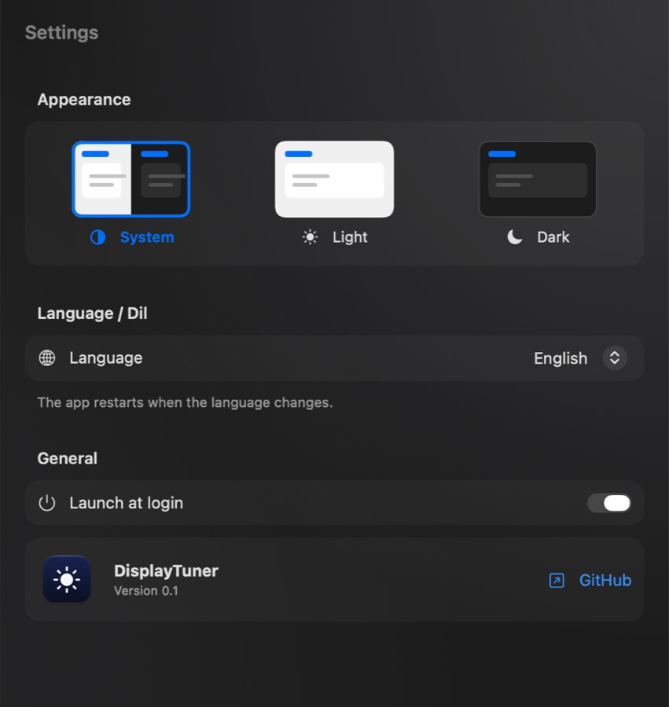

<div align="center">



# DisplayTuner

**One native macOS menu bar app for your monitor, mouse, headset and keyboard.**

[English](README.md) · [Türkçe](README.tr.md)


</div>

---

> [!IMPORTANT]
> **This is a personal project.** I built it for my own Mac and my own devices. It is **tested only on the hardware listed below**, and there is **no guarantee it works on other devices**. It talks to hardware directly and uses private macOS APIs, so use it at your own risk. Contributions that add support for more hardware are very welcome.

DisplayTuner replaces a pile of separate apps (BetterDisplay, LinearMouse, Razer Synapse, ASUS Armoury Crate and vendor keyboard tools) with one lightweight, Apple-style app. It lives in the menu bar, follows macOS design, and shows iPhone-style battery notifications.

## Screenshots

| Display | Headset EQ |
| :---: | :---: |
|  |  |
| **Mouse** | **Mouse device** |
|  |  |
| **Keyboard** | **Notifications** |
|  |  |
| **Connected devices** | **Settings** |
|  |  |

## Features

### Display
- Picks every connected display (external monitor or MacBook display): resolution, HiDPI scaling, **every supported refresh rate**, and choosing the **main display**
- Forces the monitor to **RGB Full range** and reapplies your saved color profile every time the dock is plugged in
- Hardware controls over DDC/CI: brightness, contrast, red/green/blue gain
- Software color: gamma table (contrast, gamma, highlights, shadows, color temperature, per-channel gain) and an overlay filter (saturation, vibrance, hue, sepia)
- Color profiles with hotkeys (⌃⌥1 … ⌃⌥4), plus test patterns

### Headset (Razer BlackShark V2 HyperSpeed)
- Battery level with low-battery alerts
- **10-band EQ** with a draggable curve and 14 tuned presets (Balanced, Footsteps, Distant Sounds, Cinematic, Pop, Electronic, Hip-Hop, Rock, Acoustic, Bass Boost, Movie, Voice, Night…), each editable with **Reset**, plus your own saved presets. Presets are tuned for this headset's measured sound (bright, light on bass). The EQ is saved to the headset's memory.
- Sidetone, auto power-off and dongle light

### Mouse (ASUS ROG Gladius II Wireless)
- Battery level, logo and wheel lighting (effect, color, brightness)
- Reverse scroll for the mouse only (the trackpad keeps natural scrolling), pointer speed beyond the macOS limit, linear movement (acceleration off)
- Cursor size, shape and color

### Keyboard (PUSAT K3 Pro)
- Profiles, lighting effect, brightness, speed and direction

### Everything else
- iPhone-style HUDs, notifications and a critical low-battery alert, with alert levels you choose
- Dock automation: when the dock connects, color is fixed and battery info refreshes
- Built-in color picker, light/dark theme, **English and Turkish**
- Launch at login

## Tested hardware

| Device | Model | ID |
| --- | --- | --- |
| Mac | MacBook Air M5, macOS 27 | — |
| Dock | Ugreen DisplayLink dock | — |
| Monitor | PR27R165QC | vendor 13924, model 9984 |
| Headset | Razer BlackShark V2 HyperSpeed | 1532:0565 |
| Mouse | ASUS ROG Gladius II Wireless | 0B05:18A0 |
| Keyboard | PUSAT K3 Pro | 0C45:5004 |

Device IDs are currently written in the code. Other devices will not be detected, and other monitors only get the general display features.

## Build and install

Requirements: an Apple Silicon Mac, macOS 15 or later, and Xcode 16 or later.

```bash
git clone https://github.com/okmen1306/DisplayTuner.git
cd DisplayTuner
./scripts/create-signing-cert.sh   # optional, run once: keeps macOS permissions across updates
./scripts/install.sh               # builds Release, installs to /Applications and launches it
```

On first launch, macOS asks for **Accessibility** (scroll reversal and cursor) and **Input Monitoring** (keyboard). The app has no sandbox and uses private frameworks, so it cannot be distributed through the App Store.

## How it works

- **DDC/CI** through `IOAVService` for monitor brightness, contrast and gain
- **Connection mode** (RGB Full / YCbCr, bit depth) through private `CADisplay` APIs in a short-lived helper process
- **Gamma tables** through `CGSetDisplayTransferByTable`; color filters through a transparent `CABackdropLayer` overlay
- **HID** reports for the headset, mouse and keyboard; their protocols were reverse-engineered for interoperability and are documented in [`docs/AGENT_BRIEF.md`](docs/AGENT_BRIEF.md)
- Scroll reversal through a `CGEventTap`, and pointer speed through `IOHIDEventSystemClient`

## Contributing

Contributions are welcome, especially support for **more monitors, headsets, mice and keyboards**. See [CONTRIBUTING.md](CONTRIBUTING.md).

## Disclaimer

This software is provided "as is", without warranty of any kind. It writes settings to your monitor and peripherals. It is not affiliated with Apple, Razer, ASUS, PUSAT or any monitor maker; all trademarks belong to their owners.

## License

[MIT](LICENSE)
