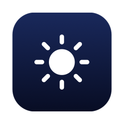
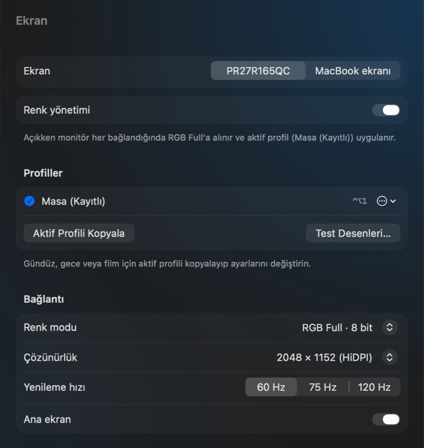
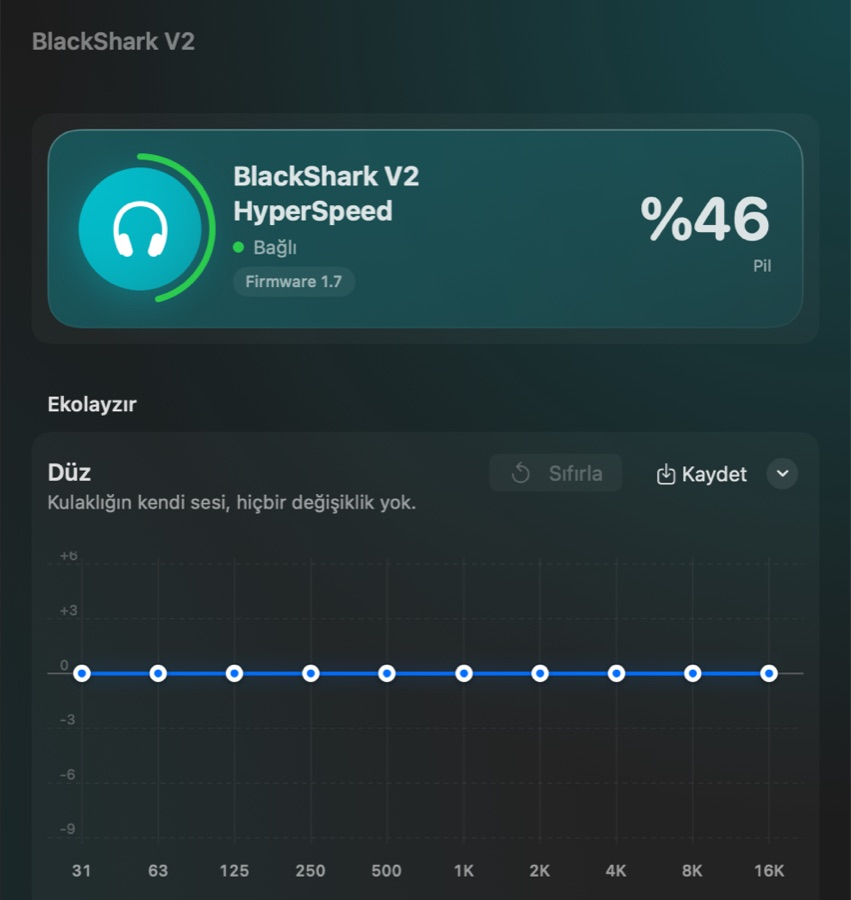
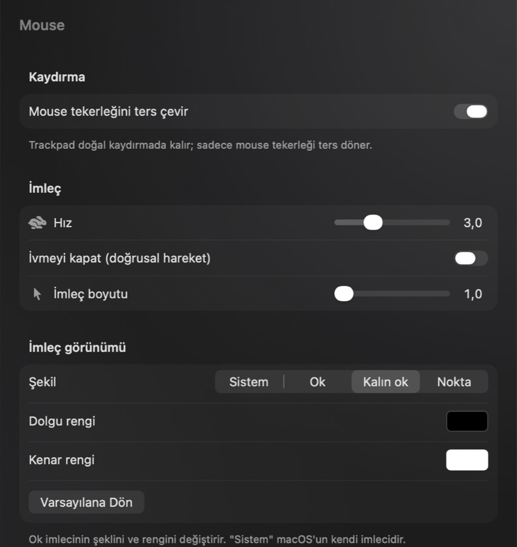
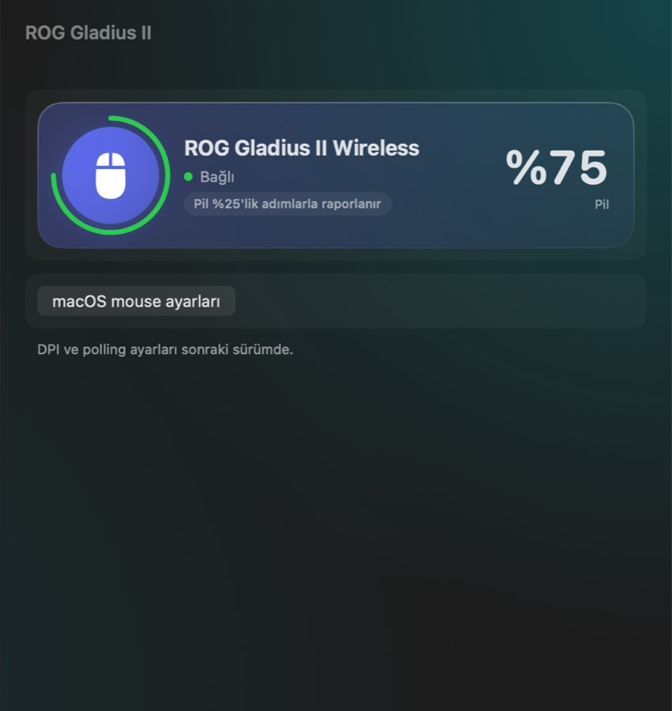
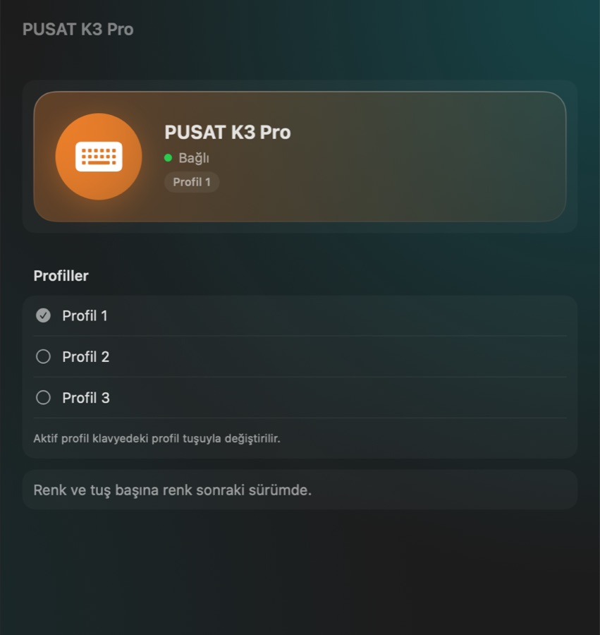
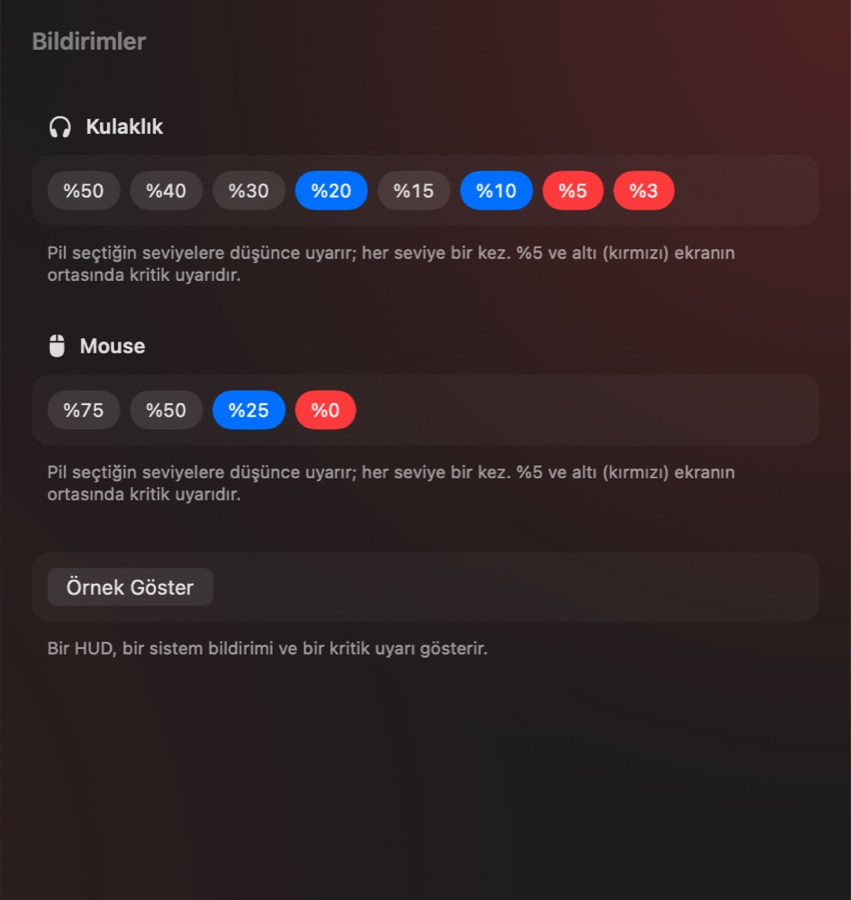
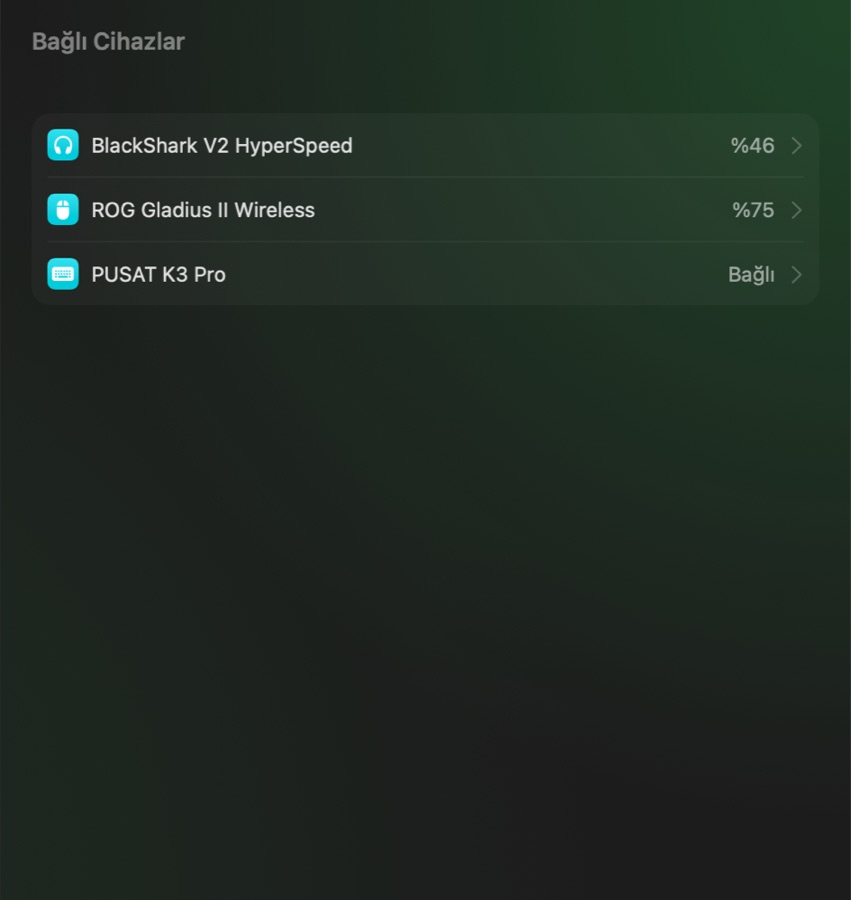
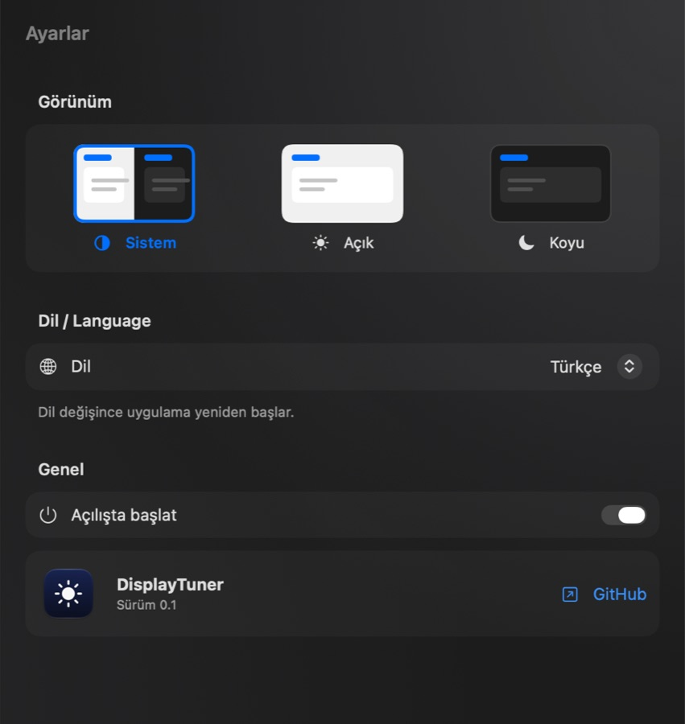

<div align="center">



# DisplayTuner

**Monitör, mouse, kulaklık ve klavye için tek, yerli görünümlü bir macOS menü bar uygulaması.**

[English](README.md) · [Türkçe](README.tr.md)


</div>

---

> [!IMPORTANT]
> **Bu kişisel bir proje.** Kendi Mac'im ve kendi cihazlarım için yazdım. **Sadece aşağıdaki donanımlarla test edildi**, başka cihazlarda **çalışacağının garantisi yok**. Donanıma doğrudan yazar ve macOS'un gizli arayüzlerini kullanır; kullanım sorumluluğu sana aittir. Yeni donanım desteği ekleyen katkılara kapımız açık.

DisplayTuner; BetterDisplay, LinearMouse, Razer Synapse, ASUS Armoury Crate ve klavye yazılımı gibi ayrı ayrı uygulamaların yerine geçen, hafif ve Apple tarzı tek bir uygulama. Menü barda yaşar, macOS tasarımına uyar ve iPhone tarzı pil bildirimleri gösterir.

## Ekran görüntüleri

| Ekran | Kulaklık EQ |
| :---: | :---: |
|  |  |
| **Mouse** | **Mouse cihazı** |
|  |  |
| **Klavye** | **Bildirimler** |
|  |  |
| **Bağlı cihazlar** | **Ayarlar** |
|  |  |

## Özellikler

### Ekran
- Bağlı her ekranı seçebilirsin (harici monitör ya da MacBook ekranı): çözünürlük, HiDPI ölçek, **desteklenen bütün yenileme hızları** ve **ana ekran** seçimi
- Dock her takıldığında monitörü **RGB Full**'a alır ve kayıtlı renk profilini yeniden uygular
- DDC/CI ile donanım ayarları: parlaklık, kontrast, kırmızı/yeşil/mavi kazanç
- Yazılımsal renk: gama tablosu (kontrast, gama, parlak alanlar, gölgeler, renk sıcaklığı, kanal kazancı) ve üst katman filtresi (doygunluk, canlılık, ton, sepya)
- Kısayollu renk profilleri (⌃⌥1 … ⌃⌥4) ve test desenleri

### Kulaklık (Razer BlackShark V2 HyperSpeed)
- Pil seviyesi ve düşük pil uyarıları
- Sürüklenebilir eğrili **10 bant EQ**: 14 hazır ayar (Dengeli, Ayak Sesi, Uzak Sesler, Sinematik, Pop, Elektronik, Hip-Hop, Rock, Akustik, Bas Güçlendirme, Film, Konuşma, Gece…). Her biri düzenlenebilir ve **Sıfırla** ile geri alınabilir; kendi ayarlarını da kaydedebilirsin. Hazır ayarlar bu kulaklığın ölçülmüş sesine göre ayarlandı (parlak, bası zayıf). EQ kulaklığın hafızasına yazılır.
- Kendi sesini duyma (sidetone), otomatik kapanma, dongle ışığı

### Mouse (ASUS ROG Gladius II Wireless)
- Pil seviyesi, logo ve tekerlek ışığı (efekt, renk, parlaklık)
- Sadece mouse için ters kaydırma (trackpad doğal kalır), macOS sınırının üstünde imleç hızı, doğrusal hareket (ivme kapalı)
- İmleç boyutu, şekli ve rengi

### Klavye (PUSAT K3 Pro)
- Profiller, ışık efekti, parlaklık, hız ve yön

### Diğer
- iPhone tarzı HUD, bildirim ve kritik düşük pil uyarısı; uyarı seviyelerini sen seçersin
- Dock otomasyonu: dock takılınca renk düzeltilir, pil bilgisi yenilenir
- Uygulama içi renk seçici, açık/koyu tema, **İngilizce ve Türkçe**
- Açılışta başlatma

## Test edilen donanım

| Cihaz | Model | Kimlik |
| --- | --- | --- |
| Mac | MacBook Air M5, macOS 27 | — |
| Dock | Ugreen DisplayLink dock | — |
| Monitör | PR27R165QC | vendor 13924, model 9984 |
| Kulaklık | Razer BlackShark V2 HyperSpeed | 1532:0565 |
| Mouse | ASUS ROG Gladius II Wireless | 0B05:18A0 |
| Klavye | PUSAT K3 Pro | 0C45:5004 |

Cihaz kimlikleri şu an koda sabit yazılı. Başka cihazlar algılanmaz; başka monitörlerde yalnızca genel ekran özellikleri çalışır.

## Derleme ve kurulum

Gereksinimler: Apple Silicon Mac, macOS 15 veya üstü, Xcode 16 veya üstü.

```bash
git clone https://github.com/okmen1306/DisplayTuner.git
cd DisplayTuner
./scripts/create-signing-cert.sh   # isteğe bağlı, bir kez: güncellemelerde macOS izinleri korunur
./scripts/install.sh               # Release derler, /Applications'a kurar ve açar
```

İlk açılışta macOS **Erişilebilirlik** (ters kaydırma ve imleç) ve **Giriş İzleme** (klavye) izni ister. Uygulama sandbox kullanmaz ve gizli framework'lere dayanır; bu yüzden App Store'da dağıtılamaz.

## Nasıl çalışır

- Monitör parlaklığı, kontrast ve kazanç için `IOAVService` üzerinden **DDC/CI**
- **Bağlantı modu** (RGB Full / YCbCr, bit derinliği) kısa ömürlü bir yardımcı süreçte gizli `CADisplay` arayüzleriyle
- `CGSetDisplayTransferByTable` ile **gama tabloları**; renk filtreleri saydam bir `CABackdropLayer` katmanıyla
- Kulaklık, mouse ve klavye için **HID** raporları; protokoller birlikte çalışabilirlik amacıyla çözüldü ve [`docs/AGENT_BRIEF.md`](docs/AGENT_BRIEF.md) içinde belgelendi
- Ters kaydırma için `CGEventTap`, imleç hızı için `IOHIDEventSystemClient`

## Katkı

Katkılara açığız; özellikle **başka monitör, kulaklık, mouse ve klavye** desteği. Ayrıntılar [CONTRIBUTING.md](CONTRIBUTING.md) dosyasında.

## Sorumluluk reddi

Bu yazılım "olduğu gibi", hiçbir garanti olmadan sunulur. Monitörüne ve çevre birimlerine ayar yazar. Apple, Razer, ASUS, PUSAT veya herhangi bir monitör üreticisiyle bağlantısı yoktur; tüm markalar sahiplerine aittir.

## Lisans

[MIT](LICENSE)
